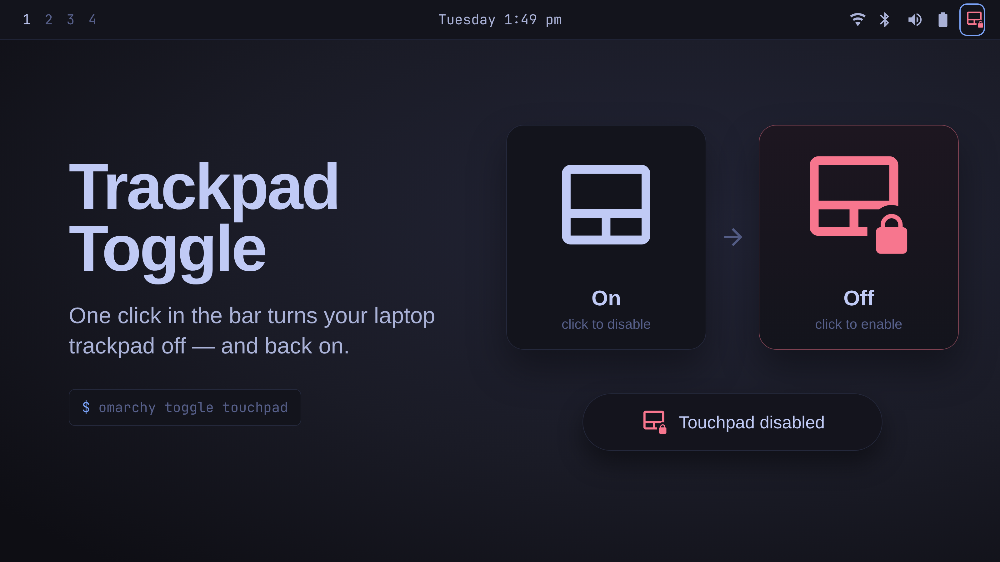

# Trackpad Toggle

An Omarchy shell bar widget that turns the laptop trackpad on and off.



- **Click** the trackpad icon to disable or enable the trackpad.
- The icon switches to a locked trackpad and highlights while the trackpad is off.
- It wraps Omarchy's built-in `omarchy toggle touchpad`, so you get the normal
  OSD, and the disabled state survives Hyprland reloads and reboots.
- The icon stays in sync when the toggle runs from a keybinding or a terminal.

## Install

```bash
omarchy plugin add https://github.com/joeyvigil/trackpad-toggle --enable
```

Or by hand, cloning straight into the plugin folder:

```bash
git clone https://github.com/joeyvigil/trackpad-toggle \
  ~/.config/omarchy/plugins/io.github.joeyvigil.trackpad-toggle
omarchy plugin enable io.github.joeyvigil.trackpad-toggle
```

## Remove

```bash
omarchy plugin remove io.github.joeyvigil.trackpad-toggle
```

If the trackpad is off when you remove the plugin, turn it back on with
`omarchy toggle touchpad on`.

## Requirements

- Omarchy with the Quickshell-based shell (Omarchy Quattro)
- A laptop trackpad that Hyprland detects

There are no other dependencies. The plugin calls Omarchy's built-in
`omarchy-toggle-touchpad` command and makes no network requests.

## Optional keybinding

Add this to `~/.config/hypr/bindings.lua` to toggle from the keyboard too:

```lua
o.bind("SUPER CTRL, T", "Toggle trackpad", "omarchy toggle touchpad")
```

## License

MIT
